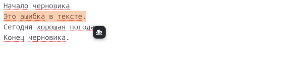
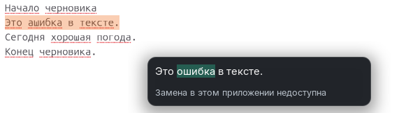
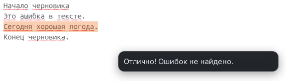

# ab

[Русский](README.ru.md)

Local-first proofreading for GNOME/Wayland. The shipped deliverable in this
repository is a GNOME Shell extension with a contextual selection-check button,
a top-bar status/pause control, and a local LanguageTool-backed preview. It does
not ship a standalone GTK window or any Firefox/browser integration.

Select Russian text and click the icon next to the selection. If the check has
no findings, a short acknowledgment disappears on its own. Corrections are
shown inline; the Replace button requires a compatible app-side editor adapter.
The experimental GNOME Text Editor adapter is available as a source patch only,
not in this development package.

## Russian-text demo

Real GNOME test session with the stock editor: selection icon, correction preview, and clean result. The stock editor does not offer Replace in this build.







## Install, update and remove

For GNOME Shell 50 / Wayland. Run the desired command in a terminal as your normal user; do not put `sudo` before `curl` or `bash`. No manual download or build is needed.

### Install

```bash
curl -fsSL https://raw.githubusercontent.com/tarantsevm/ab/main/install.sh | bash
```

### Update

```bash
curl -fsSL https://raw.githubusercontent.com/tarantsevm/ab/main/update.sh | bash
```

### Remove

```bash
curl -fsSL https://raw.githubusercontent.com/tarantsevm/ab/main/remove.sh | bash
```

Update reuses the installed engine if it matches the release. Remove disables the extension in the current GNOME session and removes the ab and engine packages.

Install and update verify the prebuilt Debian packages before calling apt. Enable **ab** in GNOME Extensions after installation. Log out and back in if the extension isn't discovered or updated. [Packages and checksums](https://github.com/tarantsevm/ab/releases/tag/v0.1.0-dev7).

## Build from source (optional)

The package is named `ab-proofread`; its GNOME Shell extension UUID and directory
are `ab_proofread@ab.local`. The pinned, unmodified LanguageTool 6.6 distribution
is packaged separately as `ab-proofread-languagetool`, with upstream license
notices retained. See `docs/engine-source.md` for provenance and checksum and
`docs/deb-lifecycle.md` for isolated install/update/remove testing.

```sh
python3 packaging/build_deb.py
python3 packaging/build_deb.py --with-engine --engine-dir /path/to/LanguageTool-6.6
```

## Tests

```sh
/usr/bin/python3 -m unittest discover -s tests -v
node --test tests/*.test.mjs
```

The native GNOME Text Editor patch preserves its upstream/GPL notices. It is a
source patch only and is not included as an installed adapter.
