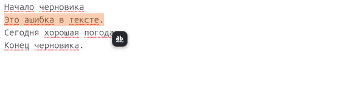
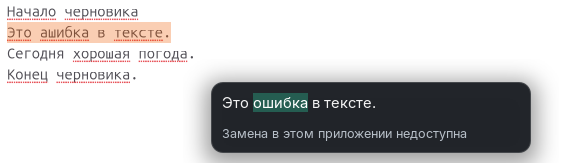
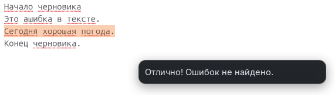

# ab

[English](README.md)

**ab** — расширение для GNOME Shell 50 (Wayland), которое локально проверяет русский текст. Отдельного окна, ярлыка запуска и расширения для браузера нет.

## Как пользоваться

1. Включите **ab** в приложении «Расширения» GNOME. Значок в верхней панели показывает статус; там же можно приостановить и возобновить проверку.
2. Выделите текст в редактируемом поле и нажмите маленький значок рядом с выделением. ab читает текст только после нажатия. На нерусском выделении значок тоже может появиться, но ab его не проверяет.
3. Если ошибок не найдено, на пару секунд появится «Отлично! Ошибок не найдено.». Если есть исправление, ab подсветит его в карточке. Кнопка «Заменить» появляется только там, где редактор поддерживает безопасную замену исходного выделения.

Проверка работает через локальный LanguageTool и не отправляет текст во внешний сервис. Ничего не заменяется автоматически.

## Демонстрация на русском

Кадры из тестового сеанса GNOME с обычным редактором: значок у выделения, предпросмотр исправления и сообщение для текста без ошибок. В этой сборке автоматическая замена в штатном редакторе недоступна.

## Установка, обновление и удаление

Для GNOME Shell 50 / Wayland. Сборка из исходников не нужна. Скачайте нужный скрипт и запустите его обычным пользователем из папки загрузок:

- [Установка](https://github.com/tarantsevm/ab/releases/download/v0.1.0-dev7/install-ab.sh) — `sh ./install-ab.sh`.
- [Обновление](https://github.com/tarantsevm/ab/releases/download/v0.1.0-dev7/update-ab.sh) — `sh ./update-ab.sh`. Уже установленный движок той же версии не скачивается заново.
- [Удаление](https://github.com/tarantsevm/ab/releases/download/v0.1.0-dev7/remove-ab.sh) — `sh ./remove-ab.sh`. Скрипт выключает расширение в текущем сеансе и удаляет только пакеты ab и его движка.

Скрипты скачивают готовые пакеты и сверяют SHA-256 до вызова `apt`. После установки включите **ab** в «Расширениях» GNOME. Если расширение не обнаружилось или после обновления остался старый код, выйдите из сеанса и войдите снова.

[Готовые пакеты и контрольные суммы](https://github.com/tarantsevm/ab/releases/tag/v0.1.0-dev7) · [Сборка из исходников](docs/deb-lifecycle.md)

**Ограничение тестовой сборки:** пакет показывает исправления, но не включает адаптер GNOME Text Editor для кнопки «Заменить». В репозитории есть [исходный патч редактора](native/gnome-text-editor/README.md); штатный редактор пакет не заменяет.
